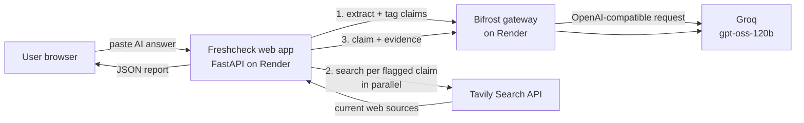

# Freshcheck: Stale-Answer Detector for AI Applications

Freshcheck takes an LLM-generated answer, finds the claims that may have gone out of date, re-verifies each one against live web sources, and returns a **0–100 freshness score per claim** with the current facts and source links.

Built for the Geek Room Global AI Hackathon 2026 (Problem Statement 06, Tavily). It uses **Tavily** for live web research and **Bifrost by Maxim AI** as the LLM gateway.

**Live demo:** https://freshcheck-nh33.onrender.com
(Hosted on free tiers, so the first request after idle can take about a minute.)

## The problem

LLMs state outdated information with full confidence: old prices, deprecated API versions, repealed laws, former office holders. Freshcheck is a verification layer that sits after the model and flags what no longer holds.

## How it works

1. **Claim identification:** an LLM splits the answer into atomic factual claims.
2. **Freshness detection:** each claim is tagged by category (pricing, API version, law/regulation, leadership, product release, statistics) and staleness risk. Timeless facts (history, math, definitions) are skipped.
3. **Live verification:** for every time-sensitive claim, Tavily searches the web in parallel and returns current sources.
4. **Freshness scoring:** an LLM judge compares the claim with the retrieved evidence and returns a verdict, a 0–100 score, a confidence level, the corrected information and the supporting URLs.

The overall score is the average of the per-claim scores.

## Architecture



| Step | Component | Role |
|---|---|---|
| Claim extraction | Bifrost → LLM | Returns structured claims with category, risk and a search query |
| Live retrieval | **Tavily** | Advanced search with up to 5 sources and snippets per claim |
| Judging | Bifrost → LLM | Verdict, score, confidence, correction, evidence URLs |
| Report | FastAPI + static page | Per-claim cards, overall score, expandable sources |

## How each required technology is used

**Tavily** provides all live information. Each flagged claim becomes a targeted query (`tavily()` in `app.py`), and the returned snippets and URLs are the only evidence the judge may use. Without Tavily, the system would be checking claims against the model's own stale memory.

**Bifrost** handles every model request (`llm()` in `app.py`). The app talks to one OpenAI-compatible endpoint, and the provider and model are set in Bifrost's configuration, not in the code. Switching from Groq to another provider means editing `bifrost/config.json` and one environment variable, with no application changes. The gateway also provides routing, fallbacks, budgets and request logging when you enable them.

## Scoring

| Score | Meaning |
|---|---|
| 90–100 | Confirmed accurate by recent sources |
| 60–89 | Mostly accurate, minor drift |
| 30–59 | Partially outdated or weak evidence |
| 0–29 | Contradicted by current sources |

Verdicts: `current`, `partially_outdated`, `outdated`, `unverifiable`. The judge is instructed to use only the supplied evidence, and to answer `unverifiable` when the evidence is insufficient. If a single claim fails to verify, the rest of the report still returns.

## Project structure

```
Freshcheck/
├── app.py              # FastAPI app: claim extraction, Tavily search, judging, scoring
├── static/index.html   # Single-page UI
├── requirements.txt
├── .env.example
├── bifrost/
│   ├── Dockerfile      # Bifrost gateway image + config
│   └── config.json     # File-only mode, Groq provider
└── README.md
```

## API

`POST /api/check`

```json
{ "answer": "OpenAI's GPT-4 costs $30 per million input tokens. ..." }
```

Returns `overall_score`, `checked` (claims with verdict, score, confidence, explanation, current_info, sources) and `timeless` (claims skipped as not time-sensitive).

`GET /health` reports the configured model and whether the keys are set. It never returns key values.

## Run locally

Requires Python 3.12, a [Tavily](https://tavily.com) API key and a running Bifrost gateway with a provider configured.

```bash
pip install -r requirements.txt
cp .env.example .env        # fill in TAVILY_API_KEY and BIFROST_URL
uvicorn app:app --reload    # http://localhost:8000
```

| Variable | Purpose |
|---|---|
| `TAVILY_API_KEY` | Tavily search key |
| `BIFROST_URL` | Bifrost chat endpoint, e.g. `https://<gateway>/v1/chat/completions` |
| `BIFROST_MODEL` | Model as `provider/model`, e.g. `groq/openai/gpt-oss-120b` |
| `BIFROST_VK` | Optional. Bifrost virtual key, sent as `x-bf-vk` |
| `BIFROST_API_KEY` | Optional. Sent as a Bearer token |

## Deploy on Render

Two services from the same repo:

**1. Bifrost gateway** (Docker)
- Root Directory: `bifrost`; leave the Docker command empty
- Environment: `GROQ_API_KEY`, `PORT=8080`
- `bifrost/config.json` runs Bifrost in file-only mode (no database), which avoids SQLite startup problems on small instances. The model must be listed in the key's `models` array.

**2. Freshcheck app** (Python 3)
- Build: `pip install -r requirements.txt`
- Start: `uvicorn app:app --host 0.0.0.0 --port $PORT`
- Environment: `TAVILY_API_KEY`, `BIFROST_URL`, `BIFROST_MODEL`, `PYTHON_VERSION=3.12.3`

## Limitations

- The judge is an LLM, so scores are evidence-based estimates rather than ground truth. Source snippets are capped at about 900 characters each.
- Answers are limited to 8,000 characters.
- Every claim is weighted equally in the overall score.
- The demo gateway leaves inference open. For production, enable gateway authentication or virtual keys.
- Free-tier hosting means cold starts and provider rate limits.

## Ideas for next steps

- Weight the overall score by staleness risk and claim importance
- Prefer official documentation domains for API and pricing claims
- Rewrite the original answer with the corrections applied
- Browser extension or API middleware that checks answers before they are shown to users
